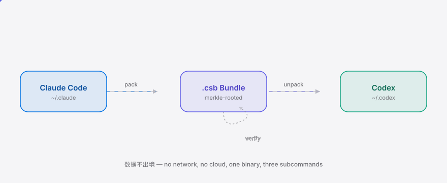

<div align="right"><sub><b>English</b>&nbsp;&nbsp;⇄&nbsp;&nbsp;<a href="./README.md">简体中文</a></sub></div>

<picture>
  <source media="(prefers-color-scheme: dark)" srcset="./assets/hero-dark.svg">
  <source media="(prefers-color-scheme: light)" srcset="./assets/hero-light.svg">
  
</picture>

<p align="center"><sub>The local Agent harness-state porter for 信创 / data-stays-in-country enterprises — pack a harness's sessions, memories, and MCP config into a verifiable migration bundle and import it into a new harness without ever leaving the intranet.</sub></p>

<p align="center">
  <a href="./LICENSE"></a>
  
  
  
  
  
</p>

---

**Switching harness = a cold start that loses learned context; CarryState packs that agent state and carries it across — without ever leaving the intranet.**

<picture>
  <source media="(prefers-color-scheme: dark)" srcset="./assets/atlas-dark.svg">
  <source media="(prefers-color-scheme: light)" srcset="./assets/atlas-light.svg">
  
</picture>

## Table of contents

- [Why this exists](#why-this-exists)
- [Architecture](#architecture)
- [Install](#install)
- [Quickstart](#quickstart)
- [Usage](#usage)
- [Demo](#demo)
- [vs cc-switch](#vs-cc-switch)
- [Enterprise / Pricing](#enterprise--pricing)
- [Roadmap](#roadmap)
- [Contributing](#contributing)

## Why this exists

Airgapped enterprise ops teams running local coding-agent harnesses on intranet-only machines under data-stays-in-country mandates hit a cold start every time they switch or upgrade a harness (Claude Code → Codex → OpenCode): the new harness owns none of the prior one's sessions, learned memories, or MCP server config, so each switch discards accumulated context. [Hoplite (Yc S26)](https://hoplite.sh) explicitly productized "we port over your local setup — sessions, memories, MCP servers" but the destination is its own cloud — 信创 intranet enterprises are structurally excluded. [farion1231/cc-switch](https://github.com/farion1231/cc-switch) (124k stars) switches which harness the launcher opens across six production harnesses — Claude Code, Codex, OpenCode, OpenClaw, Grok Build, Hermes Agent — but ports zero state: every switch is a blank-slate agent.

CarryState fills exactly this gap: a local, harness-agnostic Agent state-interchange bundle — sessions + memories + MCP config packed, schema-translated, and imported into the new harness, entirely inside the intranet. It is the airgapped answer to Hoplite (Yc S26)'s cloud-only state-porting, and a complement to cc-switch: cc-switch switches the harness; CarryState carries the state it leaves behind. That agent-state portability across harnesses is a real, on-trend need is evidenced by the multi-harness field cc-switch already serves — including [NousResearch/hermes-agent](https://github.com/NousResearch/hermes-agent) and Grok Build — which v0.2 will add as target adapters.

## Architecture

One static Go binary `carrystate`, three subcommands, four internal packages — no daemons, no network, no microservices, no K8s. That's an airgap guarantee **by construction**, not a configuration option.

- `cmd/carrystate` (cobra: pack / unpack / verify)
- `internal/bundle` — `.csb` read/write + merkle root
- `internal/harness` — adapter registry + claudecode / codex
- `internal/checksum` — per-entry sha256
- `internal/translate` — native ↔ bundle schema translation

The only I/O is reading the source harness state dir and writing the target harness state dir. `verify` re-runs a deterministic subset of the translator's round-trip and compares checksums — no LLM call in v0.1.

## Install

```bash
go install github.com/SuperMarioYL/carrystate@latest
```

Or grab a prebuilt binary from [Releases](https://github.com/SuperMarioYL/carrystate/releases/latest) (linux/darwin/windows × amd64/arm64) and USB it into the intranet — zero dependencies, zero network.

## Quickstart

```bash
# 1. pack: ~/.claude → project.csb (sessions + memories + MCP, merkle-rooted)
carrystate pack --harness claudecode --state-dir ~/.claude --out project.csb

# 2. verify: re-derive every sha256 + the merkle root (green check = ship it)
carrystate verify --bundle project.csb

# 3. unpack: project.csb → ~/.codex (Codex-native layout, lossless)
carrystate unpack --harness codex --in project.csb --state-dir ~/.codex
```

<details><summary>Sample output</summary>

```
$ carrystate pack --harness claudecode --state-dir ~/.claude --out project.csb
packed project.csb → claudecode
  sessions:    1
  memories:   1
  mcp servers: 1
  merkle root: 9542d49c31b322ed5eaa54e713f61a6dab6e8bc50270e96720baac75b612a95d
  fingerprint: 9542d49c31b3

$ carrystate verify --bundle project.csb
bundle:   project.csb
source:   claudecode
spec:     0.1
entries:  1 sessions, 1 memories, 1 mcp servers
merkle:   9542d49c31b322ed5eaa54e713f61a6dab6e8bc50270e96720baac75b612a95d
result:   4 matched, 0 mismatched
  ✓ all entries match — bundle is intact, round-trip is lossless
```

</details>

## Usage

<h2> Usage</h2>

**Migrate just one project** (filter a large `~/.claude` by project subdir):

```bash
carrystate pack --harness claudecode --state-dir ~/.claude \
  --project -Users-me-work-myapp --out myapp.csb
```

**Cross-host migration** (the typical 信创 intranet path — the bundle travels by USB / internal artifact repo and never leaves the intranet):

```bash
# source host
carrystate pack --harness claudecode --state-dir ~/.claude --out project.csb
sha256sum project.csb >> compliance-audit.log   # record the bundle fingerprint

# target host (project.csb arrived via USB / internal repo)
carrystate verify --bundle project.csb          # integrity-check first; refuse tampered bundles
carrystate unpack --harness codex --in project.csb --state-dir ~/.codex
```

**Dry-run a bundle** (inspect contents without writing):

```bash
carrystate unpack --harness codex --in project.csb --state-dir ~/.codex --dry-run
```

The full schema and entry types are in [SPEC.md](./SPEC.md). More examples in [examples/happy-path.md](./examples/happy-path.md).

## Demo

<h2> Demo</h2>

A 90-second full round-trip: `pack → verify → unpack`, with the session transcript round-tripping byte-for-byte. `docs/demo.tape` is a reproducible [vhs](https://github.com/charmbracelet/vhs) script; `.github/workflows/demo.yml` re-renders it in CI.


## vs cc-switch

CarryState complements [farion1231/cc-switch](https://github.com/farion1231/cc-switch) rather than competing — it switches the harness; CarryState carries the state it leaves behind. Honest callout: cc-switch is clearly stronger on desktop GUI and audience size.

| Axis | CarryState | cc-switch |
|---|:---:|:---:|
| Switch harness | ✓ (pack→unpack carries state) | ✓ (switches launcher) |
| Port sessions/memories/MCP | ✓ | ✗ (cold start every switch) |
| Cross-harness schema translation | ✓ (.csb interchange format) | ✗ |
| Stays inside intranet | ✓ | ✓ |
| Merkle integrity verification | ✓ (compliance-auditable) | ✗ |
| Desktop GUI | ✗ (CLI only, v0.1) | ✓ |
| Audience size | early | 124k stars |

## Enterprise / Pricing

<h2> Enterprise / Pricing</h2>

**The OSS core is free forever and feature-complete** — v0.1 has no paywalled feature. The monetization surface is an on-prem enterprise license (¥50–200k/site/yr) wrapped around the same OSS binary — you pay for compliance and service, not a feature gate:

- **信创 SLA**: 4-hour response, corporate contract + fapiao (信创 enterprises can't use Stripe/cards; v0.1's manual invoicing flow is enough).
- **Compliance-audit log bundle**: every `.csb`'s merkle root + manifest YAML drops straight into an audit trail; the licensed edition adds a packaged audit export.
- **Custom harness adapter**: a domestic harness not covered by the v0.1 pair? The license includes one-off custom adapter development.
- **On-site packing workshop**: 90-day free design-partner pilot → GA at ¥80k/site/yr (≤50 seats/site, SLA + audit); with a custom adapter up to ¥200k/site/yr.

Minimal path to a deal (this audience has no credit card): weekend ops interviews → design-partner LOI → 90-day free pilot + on-site workshop → corporate contract + 30% prepayment (~¥24k) at pilot end. **License delivery**: the same `carrystate` binary + an offline merkle-verifiable signed license file — fits the airgap.

To enquire: open an issue titled "enterprise license enquiry" on [Issues](https://github.com/SuperMarioYL/carrystate/issues).

## Roadmap

<h2> Roadmap</h2>

- [x] **m1** — `carrystate pack --harness claudecode` emits a merkle-verified `.csb` from a real `~/.claude`
- [x] **m2** — `carrystate unpack --harness codex` writes Codex-native layout + `verify` passes a behavior-equivalence test
- [x] **m3** — `SPEC.md` + bilingual README + asciinema/vhs round-trip demo + `go install` one-liner
- [ ] **v0.2** — OpenCode / Grok Build / Hermes Agent adapters (the bundle format is already symmetric; adding an adapter needs no spec change)
- [ ] **v0.2** — reverse direction (Codex → Claude Code)
- [ ] **v0.2** — LLM-based memory merge / dedup / semantic reconciliation (v0.1 is lossless deterministic translation only)
- [ ] **Future** — auto-discovery of harness state dirs, community per-harness adapter submissions

## Contributing

<h2> Contributing</h2>

Issues and PRs are both welcome. To add a harness adapter, follow the `Adapter` interface in `internal/harness/adapter.go` and the schema conventions in `SPEC.md`; the bundle format is symmetric so a new adapter needs no spec change. `go test ./...` must pass before submitting.

## Share this

```
CarryState — the airgapped agent-state porter. Pack Claude Code's sessions/memories/MCP into a merkle-verifiable .csb, import into Codex without leaving the intranet. Hoplite (Yc S26) ports state to its cloud; CarryState keeps it local. https://github.com/SuperMarioYL/carrystate
```

<p align="center"><sub><a href="./LICENSE">MIT</a> © 2026 SuperMarioYL</sub></p>
