[English](./README.en.md) · [Website](https://carrystate.lei6393.com) · [GitHub](https://github.com/SuperMarioYL/carrystate)

<picture>
  <source media="(max-width: 600px) and (prefers-color-scheme: dark)" srcset="./assets/presentation/hero-mobile-dark.svg">
  <source media="(max-width: 600px)" srcset="./assets/presentation/hero-mobile-light.svg">
  <source media="(prefers-color-scheme: dark)" srcset="./assets/presentation/hero-dark.svg">
  
</picture>

# CarryState

**把本地 Agent 状态迁移到新目录**

CarryState 将 Claude Code 会话文件、Markdown 记忆和 MCP 配置打包为 .csb 文件，校验内容后写入面向 Codex 的目录布局。

## 为什么需要它

迁移本地 Agent 环境需要处理分散在不同位置、格式不同的文件。统一的包把会话文本、指令和工具配置放在一起，并提供可查看的清单和解包前校验。

- **一个迁移包** — 可通过内部文件共享或移动介质传递 .csb 文件。
- **写入前检查** — 解包时重新计算校验值，拒绝内容不匹配的包。
- **保留会话原文** — 导出器保存原始 JSONL，导入器写回对应内容。

## 架构

<picture>
  <source media="(max-width: 600px) and (prefers-color-scheme: dark)" srcset="./assets/presentation/architecture-mobile-dark.svg">
  <source media="(max-width: 600px)" srcset="./assets/presentation/architecture-mobile-light.svg">
  <source media="(prefers-color-scheme: dark)" srcset="./assets/presentation/architecture-dark.svg">
  
</picture>

Claude Code 适配器读取 projects/<project>/*.jsonl、全局及可定位的项目 CLAUDE.md 和 MCP 条目。bundle 模块以 SHA-256 标识条目并计算 Merkle 根。Codex 适配器写出会话、为合并的 Markdown 添加来源注释，并生成 mcp.json。

| 组件 | 职责 |
| --- | --- |
| `Claude Code files` | sessions / CLAUDE.md / MCP |
| `Bundle` | manifest and entry digests |
| `Verification` | recomputed Merkle root |
| `Codex adapter` | sessions / AGENTS.md / mcp.json |

## 安装与快速上手

需要 Go 1.24+；完整示例使用 Python 3，无需安装 Agent CLI。

```bash
git clone https://github.com/SuperMarioYL/carrystate.git
cd carrystate
go build -o bin/carrystate ./cmd/carrystate
```

示例在临时目录创建合成输入，调用实际的 pack、verify 和 unpack 命令。不会读取个人 ~/.claude 或写入 ~/.codex。

```bash
python3 examples/presentation_demo.py
```

## 实际运行示例

<picture>
  <source media="(max-width: 600px) and (prefers-color-scheme: dark)" srcset="./assets/presentation/process-mobile-dark.svg">
  <source media="(max-width: 600px)" srcset="./assets/presentation/process-mobile-light.svg">
  <source media="(prefers-color-scheme: dark)" srcset="./assets/presentation/process-dark.svg">
  
</picture>

One synthetic session survives pack → verify → unpack byte-for-byte.

```text
packed example.csb → claudecode
  sessions:    1
  memories:   1
  mcp servers: 1
  merkle root: 65c311e365e4501004838cfe803ab49c5184881fef25648e85386d41efa77f5a
  fingerprint: 65c311e365e4
bundle:   example.csb
source:   claudecode
spec:     0.1
packed:   2026-09-08 02:10:03 UTC
entries:  1 sessions, 1 memories, 1 mcp servers
merkle:   65c311e365e4501004838cfe803ab49c5184881fef25648e85386d41efa77f5a
result:   4 matched, 0 mismatched
  ✓ all entries match — bundle is intact, round-trip is lossless
unpacked example.csb → codex
  state dir:      target
  sessions written:  1
  memories written: 1
  mcp servers:       1
Session bytes preserved: True
Written files: AGENTS.md, mcp.json, sessions/demo/session.jsonl
Scope: file migration only; no Codex process or MCP server started.
```

完整命令与输出保存在 [docs/demo-results.json](./docs/demo-results.json). 输入和复现代码均随仓提供。


保留已有录制供参考；上方文字示例给出当前可复现的操作。

## 用法

将 ./source-state 替换为准备导出的目录。--project 可限定一个编码后的项目子目录，--mcp-config 可指定 MCP JSON 文件。先导入新目录：导入器会写入目标文件，并不提供冲突感知合并。文件约定见 SPEC.md 和 examples/happy-path.md。

```bash
./bin/carrystate pack --harness claudecode --state-dir ./source-state --out project.csb
./bin/carrystate verify --bundle project.csb
./bin/carrystate unpack --harness codex --in project.csb --state-dir ./imported-state --dry-run
./bin/carrystate unpack --harness codex --in project.csb --state-dir ./imported-state
```

## 配置

路径均通过 CLI 参数指定。Claude Code 项目目录中的连字符可能产生歧义，因此路径还原是尽力处理。全局 Markdown 通过来源注释拼接；MCP 配置序列化为 mcp.json。包可能包含敏感会话和 MCP 环境变量，应按原始状态文件的要求选择存放位置。

## 集成与职责分工

<picture>
  <source media="(max-width: 600px) and (prefers-color-scheme: dark)" srcset="./assets/presentation/integrations-mobile-dark.svg">
  <source media="(max-width: 600px)" srcset="./assets/presentation/integrations-mobile-light.svg">
  <source media="(prefers-color-scheme: dark)" srcset="./assets/presentation/integrations-dark.svg">
  
</picture>

CarryState 负责文件打包和确定性转换；目标运行时负责识别和恢复这些文件。自 v0.3.0 起双向支持：Claude Code 导出到面向 Codex 的布局，Codex 导出回 Claude Code 布局。

| 路径 | 已实现职责 |
| --- | --- |
| Claude Code | export + import 本地文件状态 |
| CSB archive | portable checksummed bundle |
| Codex layout | write + read adapter-defined files |
| YAML sidecar | human-readable manifest |

## 限制与后续方向

- 校验值一致仅证明包内容一致，不能证明签名身份、运行时兼容性或行为等价。
- Codex 布局是适配器约定。本示例没有启动 Codex，也没有验证当前 Codex 版本能恢复导入会话。
- 记忆语义协调尚未实现（反向迁移自 v0.3.0 起已实现）。

已实现 Claude Code 与 Codex 的双向导出/导入、CSB 校验、验证、dry-run。后续方向是当前运行时兼容验证、记忆语义协调和更多适配器。本仓库没有实现托管服务或企业许可系统。

## 许可与贡献

许可见 [LICENSE](./LICENSE). 反馈问题时请提供最小输入、执行命令和实际输出。
